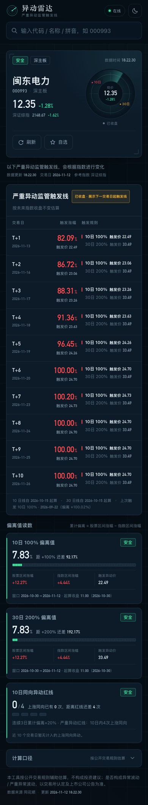
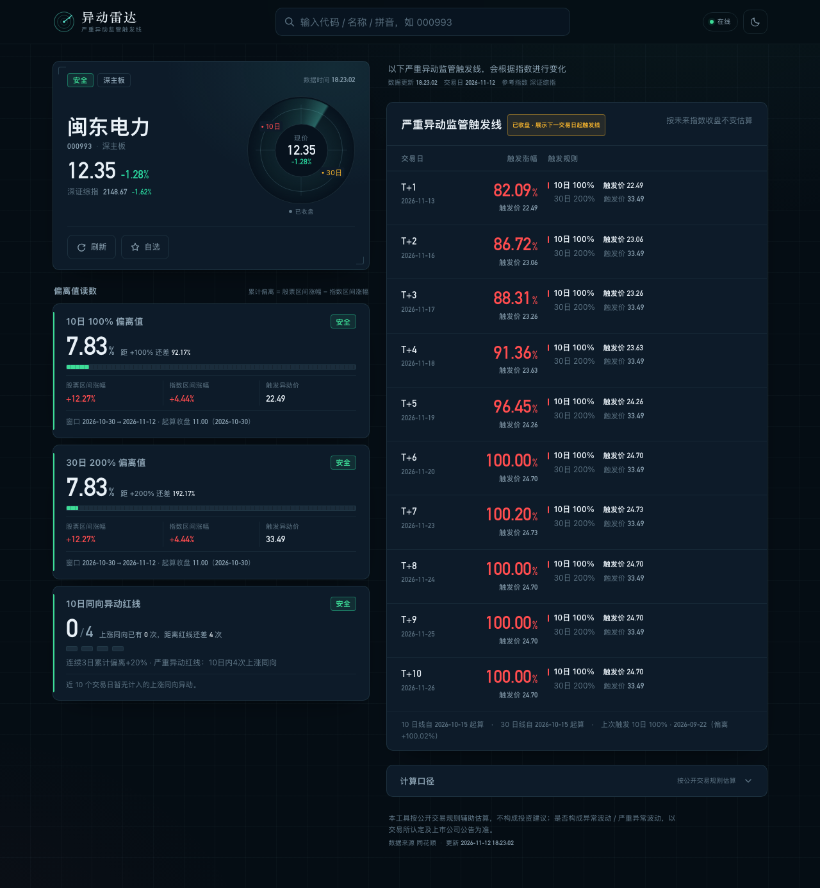
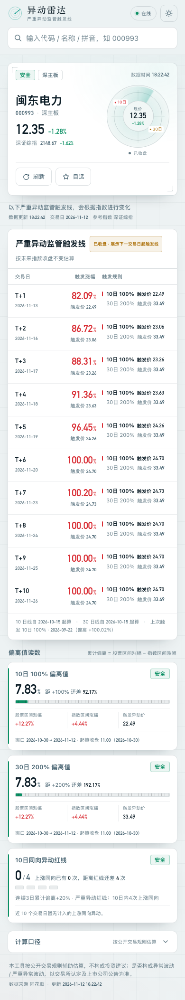
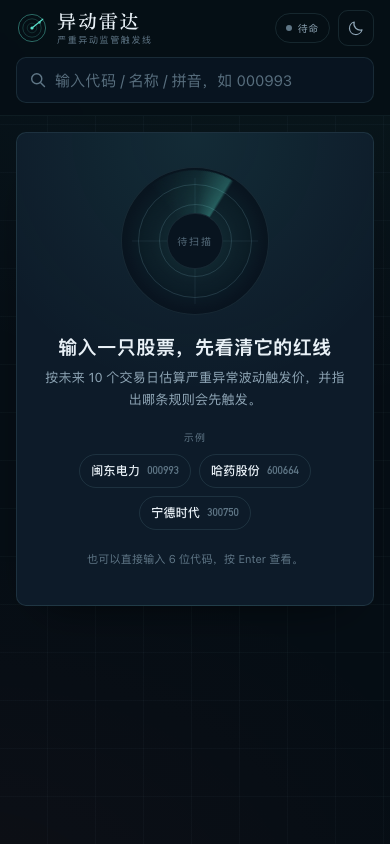
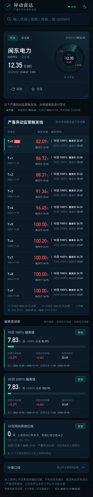
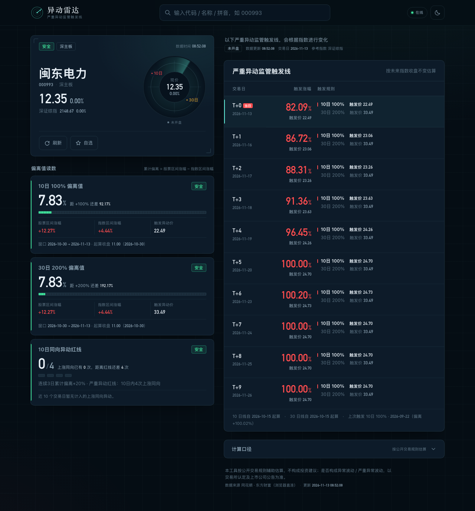

# 异动雷达 · A 股严重异动监管触发线

[](https://cheris0419.github.io/yidong-radar/)


输入 A 股代码，一眼看到**当前偏离值**与**未来 10 个交易日的严重异动监管触发价 / 触发涨幅**：
`10 日 100%`、`30 日 200%`、`十日同向异动线` 三条规则，哪条先触发、还剩多少空间。

> **在线版（免安装）**：<https://cheris0419.github.io/yidong-radar/>
> 浏览器直连公开行情，纯前端计算；也可在本地跑带缓存的 Python 服务版。

## 界面

| 移动端 · 深色 | 桌面端 · 深色 |
|---|---|
|  |  |

| 移动端 · 日间 | 首页空态 |
|---|---|
|  |  |

**在线版（GitHub Pages，实时可用）**：

| 在线版 · 移动端 | 在线版 · 桌面端 |
|---|---|
|  |  |

> 截图使用真实行情（收盘后形态 `T+1…T+10`）。交易时段展示 `T+0「当日」…T+9`。
> `docs/reference.jpg` 为用户提供的参考小程序截图，仅用于 UI 口径对照，版权归原产品所有。

## 功能

- **三条严重异动规则**：10 日累计偏离 ≥ +100%、30 日累计偏离 ≥ +200%、10 日内 4 次（主板）/ 3 次（双创）同向普通异动。
- **与主流小程序一致的口径**：累计偏离值 = 区间**最低收盘价**起算的股票区间涨跌幅 − 同期指数区间涨跌幅；
  10 日窗口 11 条有效日 K、30 日窗口 31 条；未来 K 线按现价、指数按现点位假设（“按未来指数收盘不变估算”）。
- **监管清零重演**：严重异动触发后按 10 个交易日监管期清零窗口（沪市仅清 10 日线、深市两条线均清）。
- **三条线并列展示** + 决定触发价的规则高亮；触发涨幅为负时显示「已超线」。
- **读数卡**：10 日/30 日偏离值进度、同向异动次数 `x/4`、窗口起算日、上次触发记录。
- 实时行情、收盘后自动切换 `T+1…T+10`、30 秒自动刷新（交易时段）、深色/日间主题、自选、搜索、复制价格。
- **两种部署形态**：本地 Python 服务（带重试/熔断/缓存）或纯静态 GitHub Pages（浏览器直连行情）。

## 快速开始

### 在线版

打开 <https://cheris0419.github.io/yidong-radar/>，输入代码或名称即可。零安装，但数据请求受浏览器与公开接口限制。

### 本地服务版（推荐日常使用）

要求：Python 3.10+，无需安装任何第三方依赖（标准库实现）。

```bash
git clone https://github.com/Cheris0419/yidong-radar.git
cd yidong-radar
./run.sh          # 或 python3 app.py --open
# 浏览器打开 http://127.0.0.1:8765/
```

- 数据源：东方财富（主）+ 同花顺（备），自动重试、熔断、内存 / 磁盘缓存；
- 个股日 K 使用**前复权**（与行情软件口径一致），指数不复权；
- 收盘后展示下一交易日起的触发线；非交易日自动顺延。

### 自检 / 测试

```bash
python3 app.py --selftest          # 28 项历史快照断言（离线，用 core/fixtures）
node scripts/test_site_engine.js   # 静态在线版引擎回归（25 项）
```

## 计算口径

设窗口内股票最低收盘价为 `base_close`（日期 `base_date`），该日指数收盘为 `I_base`，当前指数 `I_now`，
当前股价 `P`，阈值 `T`（1.00 / 2.00）：

```
当前累计偏离值 = (P / base_close − 1) − (I_now / I_base − 1)
触发价 X       = base_close × (T + I_now / I_base)
```

- 10 日窗口 = 最近 11 条有效日 K；30 日窗口 = 最近 31 条；区间内以股票最低收盘价起算（并列取最早）。
- 未来交易日：股票按当前价、指数按当前点位假设。
- 普通异动：连续 3 条 K 的区间偏离 ≥ +20%（主板）/ +30%（创业板、科创板）；最近 10 个交易日内主板 4 次、双创 3 次为红线。
- 严重异动触发后：监管期 10 个交易日，清零从监管期结束后一交易日起算；沪市触发 10 日线仅清 10 日线，深市两条线均清。
- 基准指数：沪市 → 上证指数；深市 → 深证综指。

完整推导、两份真实截图逐项验证与已知差异见 **[docs/METHODOLOGY.md](docs/METHODOLOGY.md)**。

## 质量验证

| 验证 | 结果 | 复跑方式 |
|---|---|---|
| 历史快照自检（与两份真实截图逐项比对） | **28 / 28 PASS** | `python3 app.py --selftest` |
| 独立复算（QA 从零实现引擎 + 主备数据源交叉核对） | **450 / 450 PASS** | `python3 qa/validate_engine.py` |
| 接口端到端（字段 / 一致性 / 错误码 / 四板块 / 历史回放） | **1978 / 1978 PASS** | `python3 qa/e2e_checks.py` |
| 前端 UI（移动 / 桌面 / 深浅主题 / 空错态 / 已超线 / 停牌） | **181 / 181 PASS** | `node qa/ui_check.mjs` |
| 静态在线版引擎（与 Python 版口径一致） | **25 / 25 PASS** | `node scripts/test_site_engine.js` |

验证报告与复现脚本见 [`qa/REPORT.md`](qa/REPORT.md)。以上命令均可在本地复跑；
`docs/ci/` 提供可选的 GitHub Actions 自检 / Pages 工作流模板（复制到 `.github/workflows/` 即可启用）。

## API

本地服务版提供 JSON API（契约见 [docs/BACKEND-CONTRACT.md](docs/BACKEND-CONTRACT.md)）：

- `GET /api/triggers?code=000993` — 触发线全量数据
- `GET /api/search?q=宁德` — 代码 / 名称 / 拼音搜索
- `GET /api/health` — 健康检查

调试用历史快照回放（仅本地开发 / QA）：

```
GET /api/triggers?code=000993&at=2026-09-18T09:54:36%2B08:00&price=19.77&index_price=2491.4
GET /api/triggers?code=600664&at=2026-08-13T18:20:05%2B08:00&price=8.86&index_price=3926.96
```

> 回放接口不是模拟盘：未显式传入 `price` 时会使用该交易日实际收盘价（存在前视），仅用于复现历史快照。

## 目录结构

```
yidong-radar/
├── app.py                  # 本地服务版 HTTP 服务（标准库，端口 8765）
├── core/
│   ├── engine.py           # 触发线引擎（纯函数）
│   ├── data_source.py      # 东方财富 / 同花顺行情 + 缓存 + 熔断
│   ├── calendar_cn.py      # 2026-2027 A 股交易日历
│   ├── selftest.py         # 历史快照自检
│   └── fixtures/           # 自检用历史日 K
├── web/                    # 前端（原生 HTML/CSS/JS，零依赖）
├── site/                   # 静态在线版（GitHub Pages）：同一套 UI + 浏览器版引擎
├── docs/                   # 契约、口径、设计说明、部署、截图
├── qa/                     # 独立复算、端到端与 UI 验收脚本及报告
├── scripts/                # 静态站构建 / 静态引擎回归
├── docs/ci/                # 可选的 GitHub Actions 工作流模板（自检 / Pages）
├── scripts/deploy_pages.sh # 发布 site/ 到 gh-pages 分支
├── Dockerfile
├── run.sh
└── README.md
```

## 部署

- **静态在线版（GitHub Pages，当前方式，已上线）**：`site/` 为纯静态站点，由
  `scripts/deploy_pages.sh` 发布到 `gh-pages` 分支（Pages Source 选 `gh-pages` 根目录）；
  改完 `web/` 前端后运行一次脚本即可更新。若仓库有 Actions `workflow` 权限，也可把
  `docs/ci/pages.yml` 复制到 `.github/workflows/` 改为 Actions 自动部署。
- **服务版（带后端）**：GitHub Pages 不能运行 Python 后端，可把仓库（含 `Dockerfile`）部署到
  Render / Railway / Fly.io / 任意容器平台，容器内 `python3 app.py --host 0.0.0.0 --port $PORT`。
  详见 [docs/DEPLOYMENT.md](docs/DEPLOYMENT.md)。

## 数据与限制

- 行情来自东方财富 / 同花顺公开接口：免费接口可能限流，服务版已做重试、熔断与备用源；
  在线版由浏览器直连，网络环境可能影响可用性。
- 在线版搜索使用东方财富 suggest JSONP，行情使用同花顺公开接口；两者均为公开网页接口，稳定性不作保证。
- 交易日历内置 2026-2027 年沪深官方休市安排，2028 年起退化为周一至周五。
- 北交所、B 股暂不支持；同向异动次数基于价格 K 线复算，交易所可能结合公告综合认定；
  「十日同向异动线」为辅助参考（参考小程序存在一日滞后的展示差异，见口径文档）。
- 除权除息按前复权价格处理，极端情况下与交易所实际监测口径可能存在细微差异。

## 免责声明

本项目按公开交易规则做**辅助估算**，不构成投资建议；是否构成异常波动 / 严重异常波动，
以交易所认定及上市公司公告为准。请勿将本工具用于任何违规用途。

## License

当前未附加开源许可证。如需商用或再分发，请先联系仓库作者。
